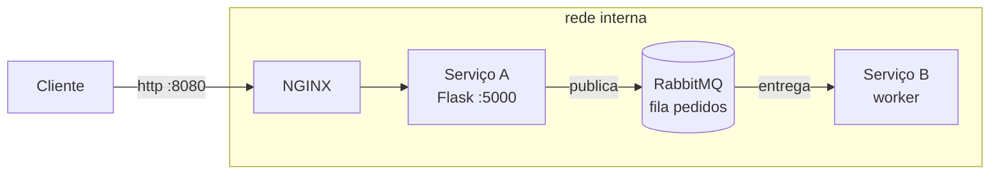
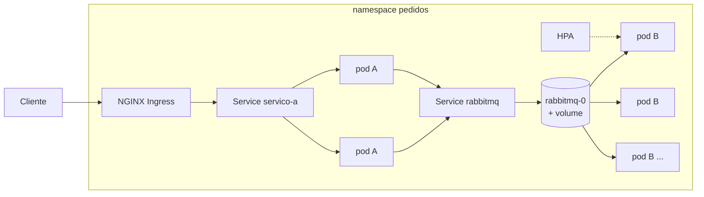

# Arquitetura

## 1. Visão geral

### Etapa 1 (Docker Compose)



São 4 containers: nginx, servico-a, servico-b e rabbitmq. Só o nginx tem porta aberta pro host (8080). Os outros ficam numa rede chamada `interna`, que foi criada com `internal: true`, ou seja, não dá pra acessar de fora.

### Etapa 2 e 3 (Kubernetes)



## 2. O que cada componente faz

- **NGINX**: é a porta de entrada. Recebe a requisição do cliente e repassa pro Serviço A. Ele também gera um `request_id` pra cada requisição e manda no header `X-Request-ID`.
- **Serviço A**: API em Flask. Recebe o pedido (`POST /pedidos`), confere se veio cliente e produto, monta a mensagem e publica na fila `pedidos` do RabbitMQ. Responde 202 (aceito) porque quem processa de verdade é o B.
- **RabbitMQ**: guarda as mensagens na fila até algum consumidor processar.
- **Serviço B**: worker. Fica escutando a fila, pega um pedido por vez e "processa". O processamento é simulado: ele fica fazendo conta por 1 segundo (pra gastar CPU, isso é importante pro HPA na etapa 3). Depois confirma com `ack`.

O Serviço A não tem nada sobre o Serviço B, nem endereço nem porta. Ele só sabe o endereço do RabbitMQ e o nome da fila. O B também só conhece o RabbitMQ. Se o B estiver desligado, o A continua funcionando normal.

## 3. Fluxo de um pedido

1. Cliente manda `POST /pedidos` pro NGINX.
2. NGINX gera o `request_id`, escreve no log e repassa pro Serviço A.
3. Serviço A escreve no log que recebeu, monta a mensagem e publica na fila.
4. Serviço A escreve no log que publicou e responde 202 pro cliente.
5. Serviço B recebe a mensagem, escreve no log, processa, dá `ack` e escreve no log que terminou.

Como o `request_id` vai junto na mensagem, dá pra achar o mesmo pedido no log de todo mundo. Exemplo (ids encurtados):

```
nginx      | 172.18.0.1 "POST /pedidos HTTP/1.1" status=202 request_id=7c1f...
servico-a  | [A] request_id=7c1f... pedido recebido: cliente=maria produto=camiseta qtd=2
servico-a  | [A] request_id=7c1f... pedido 3fa9c2d1 publicado na fila 'pedidos'
servico-b  | [B 8e2a...] request_id=7c1f... pedido 3fa9c2d1 recebido da fila (cliente=maria, produto=camiseta)
servico-b  | [B 8e2a...] request_id=7c1f... pedido 3fa9c2d1 processado
```

## 4. Formato da mensagem

A mensagem é um JSON simples:

```json
{
  "id": "3fa9c2d1",
  "request_id": "7c1f0a9e5b2d4c8f",
  "cliente": "maria",
  "produto": "camiseta",
  "quantidade": 2,
  "criado_em": "2026-10-20T14:02:11"
}
```

- `id`: id do pedido (gerado pelo Serviço A)
- `request_id`: id da requisição que veio do NGINX, usado pra seguir nos logs

## 5. RabbitMQ

A gente usou uma fila só, chamada `pedidos`, no modelo de *work queue* do tutorial do RabbitMQ.

Pra não perder pedido quando o Serviço B cai, usamos:

- **fila durável** (`durable=True`): a fila continua existindo se o RabbitMQ reiniciar
- **mensagem persistente** (`delivery_mode=2`): a mensagem é salva em disco
- **confirmação na publicação** (`confirm_delivery`): o A só responde ok depois do RabbitMQ confirmar que recebeu
- **ack manual no B**: o B só manda o `ack` depois de terminar o processamento. Se ele morrer no meio, a mensagem volta pra fila e outro worker pega
- **prefetch = 1**: cada worker pega 1 mensagem por vez. Assim, quando tem vários B, os pedidos são divididos entre eles
- **volume**: no compose é o volume `dados-rabbitmq`, no kubernetes é um PVC

**Falha controlada (etapa 1):** quando a gente para o Serviço B e faz 10 pedidos, o Serviço A continua respondendo 202 normalmente, porque ele só depende do RabbitMQ. As 10 mensagens ficam paradas na fila (`messages = 10`, `consumers = 0`). Quando o B volta, ele conecta de novo, vê que tem mensagem esperando e processa as 10, uma de cada vez. A fila volta pra 0.

**Painel do RabbitMQ:** não usamos. Pra ver a fila usamos o `rabbitmqctl` dentro do container (`scripts/fila.sh`). Por isso a imagem é a `rabbitmq:4.1` sem o management e nenhuma porta do RabbitMQ é aberta.

## 6. Rede

**Docker Compose**
- rede `externa`: só o nginx
- rede `interna` (`internal: true`): nginx, servico-a, servico-b e rabbitmq
- os containers se acham pelo nome (ex.: o nginx manda pra `servico-a:5000`, os serviços conectam em `rabbitmq`)
- só o nginx publica porta (`8080:80`). Se tentar `curl localhost:5000` não funciona

**Kubernetes**
- todos os Services são ClusterIP (só funcionam dentro do cluster)
- o Serviço B não tem Service, porque ninguém precisa acessar ele. Ele que conecta no RabbitMQ
- a entrada é o Ingress (NGINX Ingress Controller) que manda tudo pro Service `servico-a`
- no minikube a gente acessa com `kubectl port-forward` no service do ingress controller (`scripts/k8s-acesso.sh`), então a requisição continua passando pelo Ingress

## 7. Decisões na migração pro Kubernetes

| No Compose | No Kubernetes | Por quê |
|---|---|---|
| container servico-a | Deployment (2 réplicas) + Service | não guarda estado, pode ter várias cópias. O Service dá um endereço fixo mesmo quando os pods mudam |
| container servico-b | Deployment (2 réplicas), sem Service | não guarda estado e não recebe conexão |
| container rabbitmq + volume | StatefulSet (1 réplica) + PVC + Service | tem estado (as mensagens), precisa de um volume que continue existindo se o pod for recriado |
| nginx + nginx.conf | Ingress + NGINX Ingress Controller | o roteamento vira um recurso do cluster |
| variáveis no compose | ConfigMap | configuração fora da imagem |
| `.env` | Secret | a senha é criada no cluster pelo script a partir do `.env`, não fica em arquivo no git |
| depends_on | readinessProbe + reconexão | no kubernetes não tem ordem de subida. O B fica tentando conectar no rabbit a cada 5s e o A só recebe tráfego quando o `/health` responde |

As imagens são buildadas na máquina e carregadas no minikube com `minikube image load`, por isso usamos `imagePullPolicy: IfNotPresent` e não precisamos de registry (Docker Hub).

**Self-healing:** o Deployment do B diz que quer 2 réplicas. Quando a gente apaga um pod, o Kubernetes percebe que tem só 1 e cria outro sozinho. Isso é o Kubernetes comparando o estado desejado com o estado atual.

**Limitação do RabbitMQ com 1 réplica:** ele é um ponto único de falha. Se o pod `rabbitmq-0` cair, o Kubernetes recria ele com o mesmo volume e as mensagens continuam lá (a gente mostra isso na demo), mas enquanto ele está reiniciando o Serviço A responde 503 porque não consegue publicar. Num sistema de verdade teria que usar um cluster com 3 nós (quorum queues) ou um serviço gerenciado. Outra limitação é que o volume do minikube fica preso no único nó do cluster.

## 8. Escalabilidade x elasticidade

- **Escalabilidade (manual):** `kubectl scale deployment servico-b --replicas=4`. A gente que decide quantas réplicas. Com 4 workers, os pedidos da fila são divididos entre eles.
- **Elasticidade (automática):** com o HPA (`k8s/hpa/servico-b-hpa.yaml`) o próprio Kubernetes decide. Configuramos mínimo 1, máximo 5 e alvo de 50% de CPU.

Como funciona no nosso caso: cada pedido gasta 1 segundo de CPU no Serviço B. Quando mandamos 300 pedidos, o B fica processando sem parar e a CPU passa muito de 50% do `request` (100m). O HPA vê isso pelo metrics-server e aumenta as réplicas. Quando a fila acaba, a CPU cai, e depois de 1 minuto sem carga o HPA começa a tirar 1 pod a cada 30s até voltar pra 1.

O HPA calcula a porcentagem em cima do `requests.cpu`, por isso colocamos `requests` e `limits` no Deployment do B.

Usar CPU é um jeito indireto de medir a demanda. O ideal pra um worker de fila seria escalar pelo número de mensagens na fila (com KEDA por exemplo), mas isso era opcional.

Relação com o NIST: o experimento do HPA mostra a **elasticidade rápida** (recurso aumenta e diminui sozinho conforme a demanda) e também um pouco de **serviço mensurado** (o metrics-server mede o uso de cada pod pra decidir).
