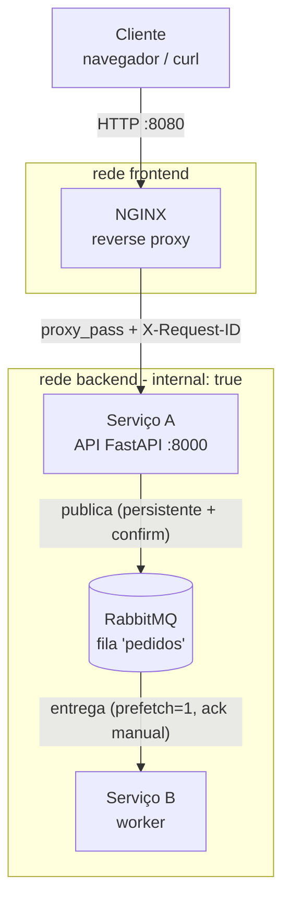
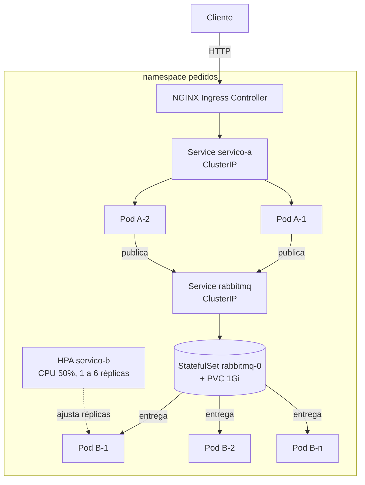

# Arquitetura implementada

## 1. Visão geral

### Etapa 1 (Docker Compose)



O NGINX é o único container ligado nas duas redes. A rede `backend` foi criada com `internal: true`, então os containers dela não têm portas publicadas no host e nem saída para a internet. Só o NGINX publica porta (`8080:80`).

### Etapa 2 e 3 (Kubernetes)



## 2. Papel de cada componente

| Componente | O que faz | O que ele conhece |
|---|---|---|
| NGINX / Ingress | Único ponto de entrada. Recebe o HTTP do cliente, gera um `X-Request-ID` e encaminha para o Serviço A. | Só o nome `servico-a` |
| Serviço A | API de pedidos. Valida o pedido, monta a mensagem e publica na fila. Responde `202 Accepted` porque o pedido ainda vai ser processado. | O broker (`rabbitmq:5672`) e o nome da fila |
| RabbitMQ | Guarda as mensagens até algum consumidor confirmar o processamento. | Nada da aplicação |
| Serviço B | Worker. Consome a fila, processa cada pedido (gasta CPU de propósito) e confirma com `ack`. Não abre porta nenhuma. | O broker e o nome da fila |

O Serviço A não tem nenhuma variável, URL ou dependência que aponte para o Serviço B, e o contrário também vale. Se trocarmos o Serviço B por outro worker escrito em outra linguagem que leia o mesmo formato de mensagem, o Serviço A nem fica sabendo.

## 3. Fluxo de uma operação

1. O cliente faz `POST /api/pedidos` no NGINX.
2. O NGINX gera o `$request_id`, registra no log e repassa no cabeçalho `X-Request-ID`.
3. O Serviço A valida o JSON (cliente e itens), cria um `pedido_id` (UUID) e publica a mensagem na fila `pedidos`.
4. O publish usa *publisher confirms*: a API só responde depois que o RabbitMQ confirmou que recebeu a mensagem. Por isso a resposta é `202` com `status: enfileirado`.
5. O RabbitMQ guarda a mensagem (fila durável + mensagem persistente).
6. Uma instância do Serviço B recebe a mensagem, processa e só então manda o `ack`. Sem `ack`, a mensagem continua pertencendo à fila.

Exemplo de como fica o rastreio pelo `request_id` (etapa 1, IDs encurtados):

```
nginx      172.18.0.1 [..] "POST /api/pedidos HTTP/1.1" status=202 ... request_id=8f3c1e...
servico-a  [servico-a 4b1d] INFO request_id=8f3c1e... requisicao recebida: novo pedido do cliente 'ana'
servico-a  [servico-a 4b1d] INFO request_id=8f3c1e... pedido_id=1c2f... publicado na fila 'pedidos'
servico-b  [servico-b 9a7e] INFO request_id=8f3c1e... pedido_id=1c2f... recebido (cliente=ana, itens=2, reentrega=False)
servico-b  [servico-b 9a7e] INFO request_id=8f3c1e... pedido_id=1c2f... processado em 301 ms (...)
```

No Kubernetes o próprio ingress-nginx gera o `X-Request-ID` e coloca no log dele, então o mesmo rastreio funciona.

## 4. Formato da mensagem

Fila: `pedidos` (exchange padrão, routing key = nome da fila). Corpo em JSON:

```json
{
  "versao": 1,
  "tipo": "pedido.criado",
  "pedido_id": "1c2f7a0e-5b0e-4d7c-9a0e-3f3c7c2d9b11",
  "request_id": "8f3c1e4b7a2d...",
  "cliente": "ana",
  "itens": [{ "produto": "caneca", "quantidade": 2 }],
  "total_itens": 2,
  "criado_em": "2026-10-20T14:02:11.532+00:00",
  "origem": "servico-a-7d9c8f6b5-x2k4p"
}
```

Propriedades AMQP: `delivery_mode=2` (persistente), `content_type=application/json`, `message_id=pedido_id`, `correlation_id=request_id`.

O campo `versao` existe para o contrato poder mudar no futuro sem quebrar consumidores antigos. Se chegar uma mensagem fora do formato, o Serviço B registra o erro e descarta (`nack` sem requeue) para não travar a fila.

## 5. Estratégia do RabbitMQ

O que garante que nenhuma mensagem se perde quando o consumidor cai:

- **Fila durável** (`durable=True`): a definição da fila sobrevive a restart do broker.
- **Mensagem persistente** (`delivery_mode=2`): a mensagem é gravada em disco.
- **Publisher confirms** no Serviço A: só consideramos publicado depois da confirmação do broker.
- **Ack manual** no Serviço B: o `ack` só é enviado depois do processamento. Se o worker morrer no meio, a mensagem volta para a fila e é entregue de novo (aparece no log com `reentrega=True`).
- **prefetch_count=1**: cada worker pega uma mensagem por vez, então quando tem várias réplicas a carga é dividida de forma justa e não fica um worker com 50 mensagens reservadas enquanto os outros estão parados.
- **Volume**: no Compose é o volume `rabbitmq-data`; no Kubernetes é um PersistentVolumeClaim criado pelo `volumeClaimTemplates` do StatefulSet.

Isso dá uma entrega "pelo menos uma vez" (*at-least-once*). Em caso de queda bem no meio, um pedido pode ser processado duas vezes. Num sistema real o Serviço B teria que ser idempotente (por exemplo, guardar os `pedido_id` já processados num banco). Como aqui o processamento não grava nada, deixamos isso como limitação conhecida.

**Desligamento gracioso do Serviço B:** quando o container recebe SIGTERM (`docker compose stop`, pod sendo removido pelo HPA etc.), o worker termina a mensagem atual, dá `ack`, cancela o consumo e sai. Mensagens que ele tinha reservado e não processou voltam para a fila.

**Painel administrativo:** não é exposto. Para ver a fila usamos `rabbitmqctl` dentro do container (`scripts/fila.sh`) ou o endpoint `/api/fila`. Se alguém precisar do painel no desenvolvimento, existe o `compose.debug.yml`, que publica a porta 15672 apenas em `127.0.0.1` e coloca o RabbitMQ numa rede `admin` separada. No Kubernetes seria via `kubectl port-forward`. Nenhum dos dois faz parte da interface da aplicação.

## 6. Rede e exposição

**Compose**

- `frontend`: rede normal, só o NGINX.
- `backend`: `internal: true`. NGINX, Serviço A, Serviço B e RabbitMQ.
- Os serviços se acham pelo nome (DNS interno do Docker). O NGINX usa `resolver 127.0.0.11 valid=10s`, então se o container do Serviço A for recriado com outro IP o NGINX acha o novo sem precisar reiniciar.
- Tentar `curl localhost:8000` no host não funciona, porque o Serviço A não publica porta.

**Kubernetes**

- Todos os Services são `ClusterIP` (só existem dentro do cluster).
- O Serviço B **não tem Service**. Ninguém precisa encontrar ele: é o worker que abre a conexão com o RabbitMQ. Isso também deixa claro que não existe como o Serviço A chamar o B diretamente.
- O RabbitMQ tem dois Services: `rabbitmq` (ClusterIP, usado pelos serviços) e `rabbitmq-headless` (exigido pelo StatefulSet para dar nome estável ao pod `rabbitmq-0`).
- A entrada é o Ingress `pedidos` (classe `nginx`) que manda tudo para o Service `servico-a`. No minikube o acesso é feito por `kubectl port-forward` **no Service do ingress controller** (`scripts/k8s-acesso.sh`), então a requisição continua passando pelo Ingress.

## 7. Decisões na migração para Kubernetes

| Compose | Kubernetes | Por quê |
|---|---|---|
| container `servico-a` | Deployment (2 réplicas) + Service | sem estado, pode ter várias cópias; o Service dá um endereço fixo mesmo com pods trocando |
| container `servico-b` | Deployment sem Service | sem estado e não recebe conexões |
| container `rabbitmq` + volume | StatefulSet (1 réplica) + PVC + Services | tem estado: precisa de nome estável e de disco que sobreviva ao pod |
| container `nginx` + `nginx.conf` | NGINX Ingress Controller + recurso Ingress | o roteamento vira um objeto declarativo do cluster |
| variáveis no `compose.yml` | ConfigMap `pedidos-config` | configuração separada da imagem |
| `.env` | Secret `rabbitmq-credenciais` | criado pelo script a partir do `.env`, não fica no Git |
| `depends_on` + healthcheck | readinessProbe / livenessProbe | no Kubernetes não existe ordem de subida; cada serviço tenta reconectar ao broker sozinho e só recebe tráfego quando está pronto |
| `restart: unless-stopped` | controlador do Deployment/StatefulSet | o cluster compara estado desejado x observado e recria o que falta |

Outros pontos:

- **Probes do Serviço A:** separamos `live` (processo de pé) de `ready` (conectado ao broker). Se o RabbitMQ cair, o pod sai do balanceamento mas não é reiniciado à toa.
- **Probe do Serviço B:** o worker atualiza o arquivo `/tmp/vivo` a cada segundo. A livenessProbe verifica se esse arquivo foi alterado no último minuto; se o processo travar, o kubelet reinicia o container.
- **Imagens:** são construídas no Docker local e carregadas no nó do minikube com `minikube image load`, por isso `imagePullPolicy: IfNotPresent` e nenhum registry externo.
- **Requests de CPU:** o Serviço B pede `100m` e tem limite de `500m`. O HPA calcula a porcentagem em cima do *request*, então sem request o HPA não funciona.

**Limitações do RabbitMQ com 1 réplica:** é um ponto único de falha. Se o pod `rabbitmq-0` cair, o Kubernetes recria ele com o mesmo volume e as mensagens persistentes continuam lá, mas durante esse intervalo o Serviço A responde `503` (não consegue publicar). Para produção o certo seria um cluster de 3 nós com *quorum queues* (por exemplo com o RabbitMQ Cluster Operator) ou um serviço gerenciado. Também usamos o StorageClass padrão do minikube (hostPath), que fica preso ao único nó do cluster.

## 8. Escalabilidade x elasticidade

- **Escalabilidade horizontal (manual):** `kubectl scale deploy servico-b --replicas=4`. Quem decide é a gente. O resultado aparece no RabbitMQ como 4 consumidores e as mensagens são divididas entre eles (cada worker processa uma por vez por causa do prefetch=1).
- **Elasticidade (automática):** o HPA (`k8s/hpa/servico-b-hpa.yaml`) olha a CPU média dos pods do Serviço B a cada ~15s e calcula `réplicas desejadas = réplicas atuais x (CPU atual / 50%)`, respeitando o mínimo 1 e máximo 6.

Por que funciona aqui: cada pedido gasta CPU de propósito (`PROCESSAMENTO_MS=300`). Com fila cheia, os workers ficam ocupados o tempo todo e a CPU vai muito acima de 50% do request. O HPA sobe réplicas (até 2 a cada 15s). Quando a fila esvazia a CPU cai quase a zero, e depois de 60s de janela de estabilização ele remove 1 pod a cada 30s até voltar para 1. Esse comportamento mais lento na descida evita ficar criando e destruindo pod se a carga oscilar.

A métrica de CPU é um jeito indireto de medir demanda. O mais correto para um worker de fila seria escalar pelo tamanho da fila (mensagens aguardando), mas isso precisa de métricas externas (por exemplo KEDA ou Prometheus Adapter) e não era requisito mínimo.

Relação com a definição do NIST: o experimento mostra na prática a **elasticidade rápida** (recursos alocados e liberados conforme a demanda, sem intervenção manual) e de leve o **serviço mensurado** (o metrics-server medindo o consumo de cada pod para tomar a decisão).
